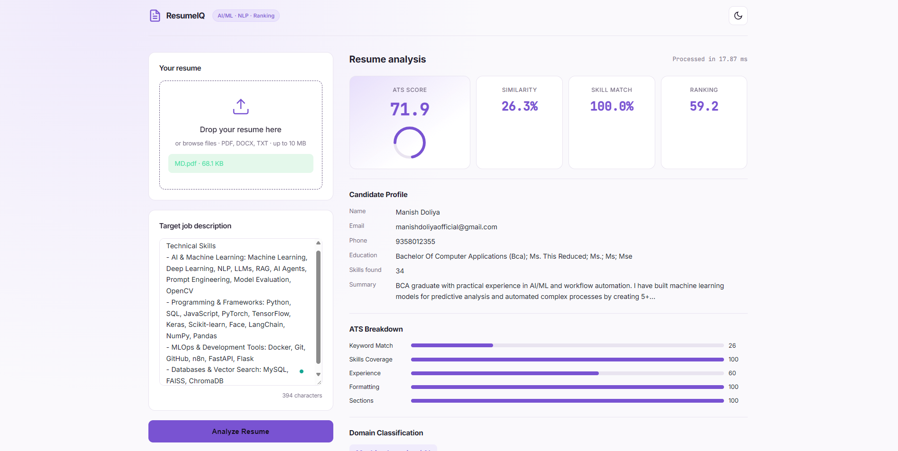
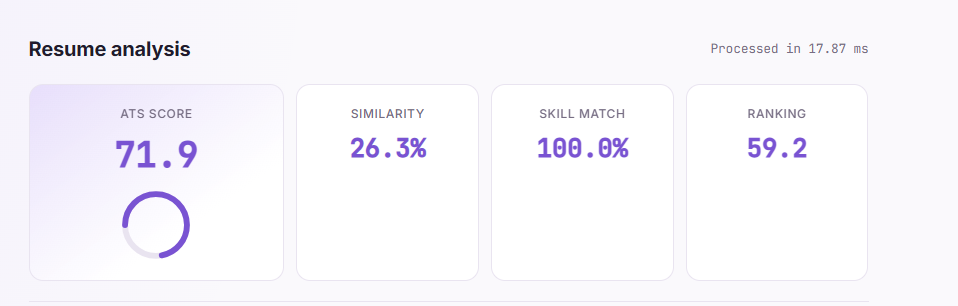

# ResumeIQ — ATS Resume Intelligence

ResumeIQ analyzes a resume against a target job description and provides an ATS-style score, skill overlap, missing skills, domain prediction, keyword alignment, and practical recommendations.

## Screenshots

### Dashboard



### ATS Score & Analysis



## Features

- Resume parsing for PDF, DOCX, and TXT
- Taxonomy-based skill extraction with domain grouping
- TF-IDF and cosine-similarity matching
- Multi-factor ATS-style score breakdown
- Matched skills and missing skill identification
- Domain classification and candidate ranking
- Candidate profile extraction and recommendations
- Responsive purple-themed interface
- Dark and light theme support

## Tech Stack

- **Backend:** Python, FastAPI, Pydantic
- **Machine Learning:** scikit-learn, NumPy, NLTK
- **Document Parsing:** PyMuPDF, python-docx
- **Frontend:** HTML, CSS, JavaScript

## Run Locally

Python 3.10 or newer is recommended.

Create and activate a virtual environment:

```bash
python -m venv .venv
```

**Windows (PowerShell):**

```powershell
.venv\Scripts\Activate.ps1
```

**macOS / Linux:**

```bash
source .venv/bin/activate
```

Install dependencies and start the application:

```bash
pip install -r requirements.txt
python run.py
```

Open http://127.0.0.1:8000 in your browser.

## API Endpoints

| Method | Endpoint | Description |
|---|---|---|
| GET | `/` | Web dashboard |
| GET | `/api/health` | Health check |
| POST | `/api/analyze` | Analyze a resume against a job description |
| GET | `/api/skills/taxonomy` | Get the skill taxonomy |
| POST | `/api/skills/extract` | Extract skills from text |

The `/api/analyze` endpoint accepts multipart form fields named `resume` and `job_description`.

## Run Tests

```bash
pytest -q
```

## Notes

ATS scores are heuristic decision-support estimates. They do not guarantee how a specific employer's ATS will rank a resume. Scanned or image-only PDFs may require OCR before analysis.
